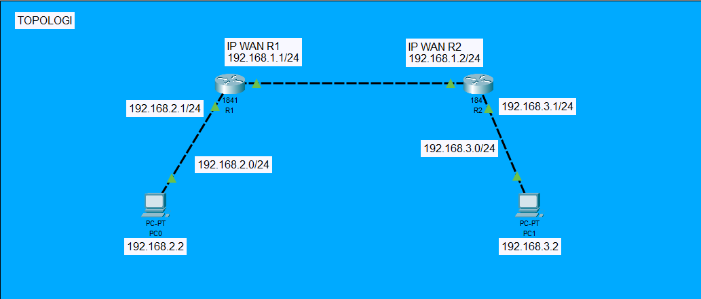

# Praktikum Routing RIPv2

Repositori ini berisi simulasi dan dokumentasi praktikum routing dinamis RIPv2 menggunakan Cisco Packet Tracer. Dua router Cisco 1841 (R1 dan R2) menghubungkan dua PC (PC0 dan PC1) pada LAN yang berbeda.

## Topologi



Jalur komunikasi: **PC0 → R1 → R2 → PC1**.

| Jaringan | Fungsi |
| --- | --- |
| 192.168.1.0/24 | Koneksi antar-router |
| 192.168.2.0/24 | LAN PC0 melalui R1 |
| 192.168.3.0/24 | LAN PC1 melalui R2 |

## Berkas Praktikum

- [Laporan lengkap](laporan-praktikum-ripv2.md): tujuan, lingkungan, pengalamatan, konfigurasi perangkat, hasil pengujian, dan analisis.
- [Simulasi Packet Tracer](topologi-2R.pkt): berkas topologi praktikum.
- [Folder pengujian](pengujian/): gambar topologi, konfigurasi, dan bukti pengujian.

## Membuka dan Memverifikasi Simulasi

1. Buka Cisco Packet Tracer, pilih **File → Open**, lalu buka `topologi-2R.pkt`.
2. Pada tab **CLI** masing-masing router, periksa protokol dan tabel routing:

   ```text
   show ip protocols
   show ip route
   ```

3. Pada **Desktop → Command Prompt** PC0, jalankan `ping 192.168.3.2`. Pada PC1, jalankan `ping 192.168.2.2`.
4. Pada CLI R1, jalankan `traceroute 192.168.3.2`. Pada CLI R2, jalankan `traceroute 192.168.2.2` untuk memeriksa jalur ke PC di LAN seberang.

Detail konfigurasi router dan pengaturan IP PC tersedia pada laporan lengkap. Versi Packet Tracer yang digunakan pada praktikum tidak tercantum dalam bukti.

## Ringkasan Hasil

Berdasarkan tangkapan layar yang tersedia:

- RIPv2 aktif pada kedua router. R1 mempelajari LAN 192.168.3.0/24 melalui 192.168.1.2, sedangkan R2 mempelajari LAN 192.168.2.0/24 melalui 192.168.1.1.
- Ping PC0 menuju PC1 mengalami kehilangan paket 50% pada percobaan pertama dan 0% pada pengulangan. Ping PC1 menuju PC0 berhasil dengan kehilangan paket 0%.
- Traceroute dari masing-masing router mencapai PC di LAN seberang melalui dua hop yang ditampilkan: router berikutnya dan PC tujuan.

**Catatan dokumentasi:** nama berkas gambar ping tertukar dengan identitas PC sumber. `pengujian/ping-PC1.png` menampilkan pengujian dari **PC0**, sedangkan `pengujian/ping-PC0.png` menampilkan pengujian dari **PC1**. Identitas pada jendela tangkapan layar menjadi acuan arah pengujian.
