# Laporan Praktikum Routing Dinamis RIPv2

## 1. Tujuan Praktikum

Praktikum ini bertujuan untuk:

1. Mengonfigurasi alamat IP dan mengaktifkan antarmuka pada dua router yang menghubungkan dua jaringan lokal.
2. Mengonfigurasi Routing Information Protocol version 2 (RIPv2) agar kedua router dapat bertukar informasi rute.
3. Mengidentifikasi jaringan yang terhubung langsung dan jaringan yang dipelajari melalui RIP pada tabel routing.
4. Memverifikasi konektivitas antar-LAN menggunakan ping serta mengamati jalur paket menggunakan traceroute.
5. Menganalisis kesesuaian konfigurasi, informasi protokol routing, dan hasil pengujian.

## 2. Lingkungan Praktikum

| Komponen | Keterangan |
| --- | --- |
| Aplikasi simulasi | Cisco Packet Tracer; versi aplikasi tidak tersedia pada bukti |
| Berkas simulasi | [topologi-2R.pkt](topologi-2R.pkt) |
| Router | Dua router Cisco 1841, diberi nama R1 dan R2 |
| Perangkat akhir | Dua PC-PT, diberi nama PC0 dan PC1 |
| Antarmuka router | FastEthernet0/0 dan FastEthernet0/1 |
| Pengalamatan | IPv4 dengan subnet mask 255.255.255.0 (/24) |
| Protokol routing | RIPv2 |
| Verifikasi | `show ip protocols`, `show ip route`, `ping`, dan `traceroute` |
| Sumber dokumentasi | Sebelas gambar pada folder `pengujian` |

Laporan ini disusun dari gambar topologi, tangkapan layar konfigurasi, dan hasil pengujian yang tersedia. Simulasi tidak dijalankan ulang dan konfigurasi internal berkas `.pkt` tidak diperiksa. Karena itu, hasil yang dilaporkan terbatas pada bukti tangkapan layar tersebut.

## 3. Deskripsi Topologi dan Perangkat

### 3.1. Susunan Topologi

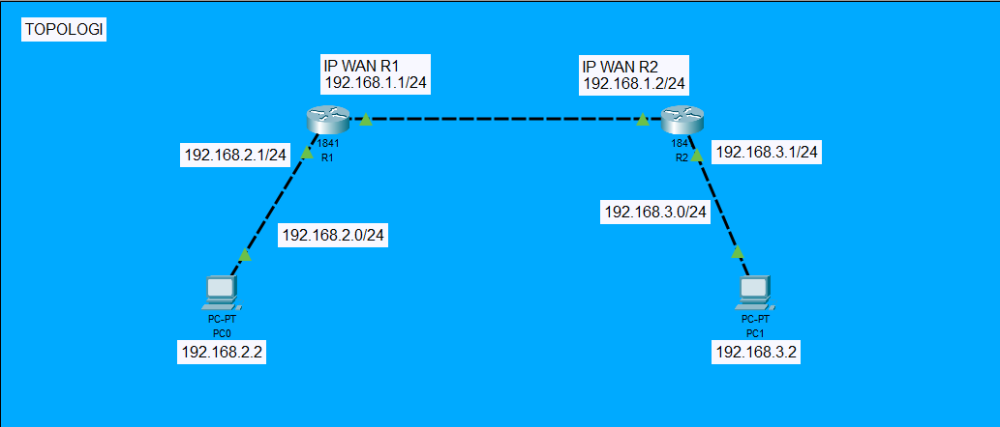

*Gambar 1. Topologi jaringan praktikum RIPv2.*

Topologi terdiri atas dua LAN yang dihubungkan melalui jaringan antar-router. PC0 terhubung langsung ke R1, sedangkan PC1 terhubung langsung ke R2. Kedua router terhubung melalui antarmuka FastEthernet0/1. Jalur komunikasi antar-PC adalah:

```text
PC0 — R1 — R2 — PC1
```

Terdapat tiga subnet yang berbeda:

| Jaringan | Fungsi | Perangkat yang terhubung |
| --- | --- | --- |
| 192.168.1.0/24 | Jaringan antar-router, diberi label WAN pada topologi | R1 dan R2 |
| 192.168.2.0/24 | LAN di sisi R1 | R1 dan PC0 |
| 192.168.3.0/24 | LAN di sisi R2 | R2 dan PC1 |

R1 bertindak sebagai gateway bagi PC0, sedangkan R2 bertindak sebagai gateway bagi PC1. Agar paket dapat mencapai LAN di sisi router lain, setiap router memerlukan rute menuju jaringan tersebut. Pada praktikum ini, rute tersebut dipelajari melalui RIPv2.

### 3.2. Tabel Pengalamatan

| Perangkat | Antarmuka | Alamat IP | Subnet mask | Default gateway |
| --- | --- | --- | --- | --- |
| R1 | FastEthernet0/0 | 192.168.2.1 | 255.255.255.0 (/24) | — |
| R1 | FastEthernet0/1 | 192.168.1.1 | 255.255.255.0 (/24) | — |
| R2 | FastEthernet0/0 | 192.168.3.1 | 255.255.255.0 (/24) | — |
| R2 | FastEthernet0/1 | 192.168.1.2 | 255.255.255.0 (/24) | — |
| PC0 | Antarmuka jaringan PC | 192.168.2.2 | 255.255.255.0 (/24)* | 192.168.2.1* |
| PC1 | Antarmuka jaringan PC | 192.168.3.2 | 255.255.255.0 (/24)* | 192.168.3.1* |

\* Subnet mask dan default gateway PC merupakan pengaturan yang disimpulkan dari subnet pada topologi dan alamat antarmuka LAN router. Tangkapan layar konfigurasi IP PC tidak tersedia. Alamat IP PC tercantum pada gambar topologi.

## 4. Konfigurasi Perangkat

### 4.1. Konfigurasi Router R1

Berikut rekonstruksi perintah yang berhasil pada tangkapan layar konfigurasi R1. Singkatan perintah ditulis dalam bentuk lengkap untuk memudahkan pembacaan.

```text
enable
configure terminal
hostname R1
interface FastEthernet0/1
 ip address 192.168.1.1 255.255.255.0
 no shutdown
 exit
interface FastEthernet0/0
 ip address 192.168.2.1 255.255.255.0
 no shutdown
 exit
router rip
 version 2
 network 192.168.2.0
 network 192.168.1.0
```

FastEthernet0/1 digunakan untuk menghubungkan R1 dengan R2, sedangkan FastEthernet0/0 digunakan untuk menghubungkan R1 dengan PC0. Perintah `no shutdown` mengaktifkan masing-masing antarmuka. Perintah `router rip` dan `version 2` mengaktifkan proses RIP dengan versi 2, sedangkan perintah `network` mengikutsertakan jaringan yang terhubung ke R1 dalam proses RIP.

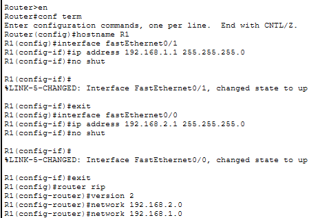

*Gambar 2. Konfigurasi alamat IP, aktivasi antarmuka, dan RIPv2 pada R1.*

### 4.2. Konfigurasi Router R2

Berikut rekonstruksi perintah yang berhasil pada tangkapan layar konfigurasi R2:

```text
enable
configure terminal
hostname R2
interface FastEthernet0/1
 ip address 192.168.1.2 255.255.255.0
 no shutdown
 exit
interface FastEthernet0/0
 ip address 192.168.3.1 255.255.255.0
 no shutdown
 exit
router rip
 version 2
 network 192.168.1.0
 network 192.168.3.0
```

FastEthernet0/1 digunakan untuk koneksi ke R1, sedangkan FastEthernet0/0 digunakan untuk koneksi ke PC1. R2 mengikutsertakan jaringan 192.168.1.0 dan 192.168.3.0 dalam proses RIP.

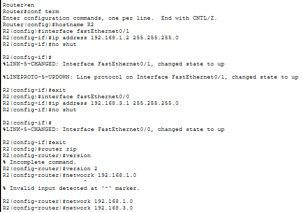

*Gambar 3. Konfigurasi R2 dan koreksi kesalahan masukan perintah.*

Pada konfigurasi R2 terlihat dua kesalahan yang kemudian diperbaiki:

| Masukan awal | Respons perangkat | Koreksi |
| --- | --- | --- |
| `version` | `% Incomplete command.` karena nomor versi belum diberikan | `version 2` |
| `netwsoork 192.168.1.0` | `% Invalid input detected at '^' marker.` karena kata kunci salah ketik | `network 192.168.1.0` |

Perintah yang gagal tidak dimasukkan ke dalam rekonstruksi konfigurasi yang berhasil. Kedua router tidak diberi tambahan perintah `no auto-summary`, karena hasil `show ip protocols` justru memperlihatkan bahwa automatic summarization masih aktif.

### 4.3. Pengaturan PC0 dan PC1

Pengaturan PC yang sesuai dengan topologi dapat dilakukan dengan membuka perangkat PC pada Cisco Packet Tracer, kemudian memilih **Desktop → IP Configuration → Static** dan mengisi nilai berikut:

| Parameter | PC0 | PC1 |
| --- | --- | --- |
| IP address | 192.168.2.2 | 192.168.3.2 |
| Subnet mask | 255.255.255.0 | 255.255.255.0 |
| Default gateway | 192.168.2.1 | 192.168.3.1 |

Gateway diarahkan ke antarmuka router pada LAN masing-masing agar PC dapat mengirim paket ke subnet lain. Tabel ini merupakan panduan pengaturan berdasarkan topologi, bukan transkripsi tangkapan layar konfigurasi PC.

## 5. Hasil Pengujian dan Analisis

### 5.1. Verifikasi Protokol Routing

Perintah yang digunakan pada masing-masing router adalah:

```text
show ip protocols
```

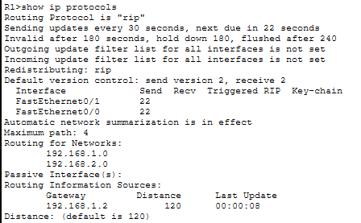

*Gambar 4. Informasi protokol RIP pada R1.*

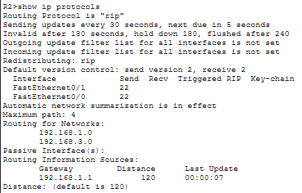

*Gambar 5. Informasi protokol RIP pada R2.*

| Parameter | R1 | R2 |
| --- | --- | --- |
| Protokol aktif | RIP | RIP |
| Versi pengiriman/penerimaan | Versi 2 / versi 2 | Versi 2 / versi 2 |
| Jaringan pada proses RIP | 192.168.1.0 dan 192.168.2.0 | 192.168.1.0 dan 192.168.3.0 |
| Sumber informasi routing | 192.168.1.2 | 192.168.1.1 |
| Administrative distance | 120 | 120 |
| Interval pembaruan | 30 detik | 30 detik |
| Invalid / hold down / flush | 180 / 180 / 240 detik | 180 / 180 / 240 detik |
| Automatic summarization | Aktif | Aktif |

Keluaran `send version 2, receive 2` menunjukkan bahwa kedua router menggunakan RIPv2 untuk mengirim dan menerima pembaruan routing. Sumber informasi routing pada R1 adalah alamat R2 di jaringan antar-router, sedangkan pada R2 adalah alamat R1. Hasil ini menunjukkan bahwa masing-masing router telah menerima informasi routing dari router di seberangnya.

Keluaran `Automatic network summarization is in effect` menunjukkan bahwa peringkasan jaringan otomatis masih aktif. Pada hasil yang tersedia, rute LAN tujuan tetap tercatat sebagai jaringan /24 pada tabel routing, sehingga konfigurasi tersebut mendukung konektivitas pada topologi yang diuji.

### 5.2. Verifikasi Tabel Routing

Perintah yang digunakan adalah:

```text
show ip route
```

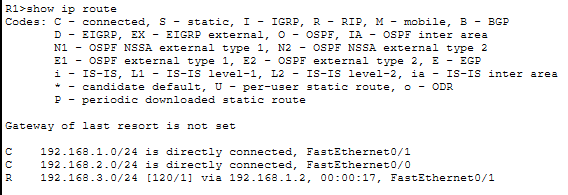

*Gambar 6. Jaringan terhubung langsung dan rute RIP pada R1.*

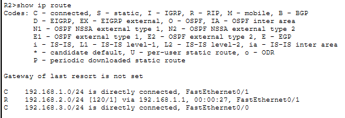

*Gambar 7. Jaringan terhubung langsung dan rute RIP pada R2.*

| Router | Kode | Jaringan tujuan | Next hop | Antarmuka keluar | Keterangan |
| --- | --- | --- | --- | --- | --- |
| R1 | C | 192.168.1.0/24 | Terhubung langsung | FastEthernet0/1 | Jaringan antar-router |
| R1 | C | 192.168.2.0/24 | Terhubung langsung | FastEthernet0/0 | LAN PC0 |
| R1 | R | 192.168.3.0/24 | 192.168.1.2 | FastEthernet0/1 | Dipelajari melalui RIP, [120/1] |
| R2 | C | 192.168.1.0/24 | Terhubung langsung | FastEthernet0/1 | Jaringan antar-router |
| R2 | R | 192.168.2.0/24 | 192.168.1.1 | FastEthernet0/1 | Dipelajari melalui RIP, [120/1] |
| R2 | C | 192.168.3.0/24 | Terhubung langsung | FastEthernet0/0 | LAN PC1 |

Kode `C` menunjukkan jaringan yang terhubung langsung, sedangkan kode `R` menunjukkan rute yang dipelajari melalui RIP. Nilai `[120/1]` berarti administrative distance sebesar 120 dan metrik RIP sebesar satu hop. Metrik ini menunjukkan bahwa jaringan tujuan dicapai melalui satu router berikutnya.

R1 telah memiliki rute menuju LAN PC1 melalui next hop 192.168.1.2. Sebaliknya, R2 telah memiliki rute menuju LAN PC0 melalui next hop 192.168.1.1. Kedua rute tersebut menyediakan jalur pergi dan kembali untuk komunikasi antar-LAN. Keluaran `Gateway of last resort is not set` menunjukkan tidak adanya default route; jaringan tujuan pada pengujian ini sudah memiliki rute spesifik.

### 5.3. Pengujian Ping Antar-PC

Identitas perangkat pada jendela tangkapan layar digunakan sebagai acuan arah pengujian. Nama berkas `ping-PC1.png` memuat pengujian dari **PC0**, sedangkan `ping-PC0.png` memuat pengujian dari **PC1**.

#### 5.3.1. PC0 menuju PC1

Perintah pada PC0:

```text
ping 192.168.3.2
```

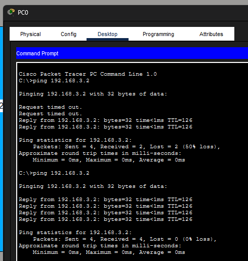

*Gambar 8. Ping dari PC0 menuju PC1, disimpan dalam berkas ping-PC1.png.*

Pada percobaan pertama, dua paket awal menghasilkan `Request timed out.`, sedangkan dua paket berikutnya memperoleh balasan. Statistik menunjukkan empat paket dikirim, dua diterima, dan dua hilang atau kehilangan paket sebesar 50%. Setelah perintah yang sama diulang, seluruh empat paket memperoleh balasan sehingga kehilangan paket menjadi 0%.

Balasan yang berhasil menampilkan `time<1ms` dan `TTL=126`. Statistik waktu perjalanan pulang-pergi pada tangkapan layar menunjukkan minimum, maksimum, dan rata-rata sebesar 0 ms sesuai pembulatan keluaran simulator.

Timeout awal **diduga** berkaitan dengan proses resolusi ARP atau kesiapan jaringan saat pengujian dimulai. Bukti yang tersedia tidak mencakup tabel ARP, urutan kejadian simulasi, atau waktu konvergensi sehingga penyebab pastinya tidak dapat dipastikan. Pengujian ulang membuktikan keberhasilan konektivitas pada saat pengulangan dilakukan.

#### 5.3.2. PC1 menuju PC0

Perintah pada PC1:

```text
ping 192.168.2.2
```

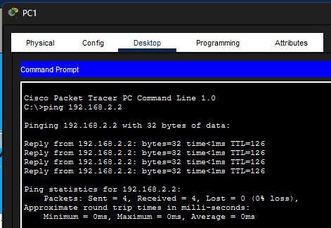

*Gambar 9. Ping dari PC1 menuju PC0, disimpan dalam berkas ping-PC0.png.*

Seluruh empat paket yang dikirim memperoleh balasan, sehingga jumlah paket hilang adalah nol dan persentase kehilangan paket sebesar 0%. Balasan menampilkan `time<1ms` dan `TTL=126`, dengan statistik minimum, maksimum, dan rata-rata sebesar 0 ms. Hasil ini menunjukkan bahwa PC1 dapat menjangkau PC0 melalui kedua router.

### 5.4. Pengujian Traceroute

#### 5.4.1. R1 menuju PC1

Perintah pada R1:

```text
traceroute 192.168.3.2
```

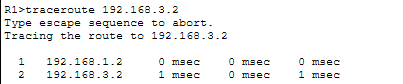

*Gambar 10. Jalur dari R1 menuju PC1.*

| Hop | Alamat yang ditampilkan | Identitas | Waktu tiga probe |
| --- | --- | --- | --- |
| 1 | 192.168.1.2 | Antarmuka R2 pada jaringan antar-router | 0 ms, 0 ms, 0 ms |
| 2 | 192.168.3.2 | PC1 sebagai tujuan | 1 ms, 0 ms, 1 ms |

Traceroute memperlihatkan bahwa paket dari R1 diteruskan ke R2 sebelum mencapai PC1. Next hop ini sesuai dengan rute RIP menuju 192.168.3.0/24 pada tabel routing R1.

#### 5.4.2. R2 menuju PC0

Perintah pada R2:

```text
traceroute 192.168.2.2
```

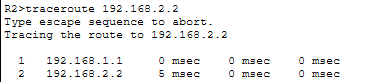

*Gambar 11. Jalur dari R2 menuju PC0.*

| Hop | Alamat yang ditampilkan | Identitas | Waktu tiga probe |
| --- | --- | --- | --- |
| 1 | 192.168.1.1 | Antarmuka R1 pada jaringan antar-router | 0 ms, 0 ms, 0 ms |
| 2 | 192.168.2.2 | PC0 sebagai tujuan | 0 ms, 0 ms, 0 ms |

Paket dari R2 melewati R1 sebelum mencapai PC0. Jalur ini sesuai dengan rute RIP menuju 192.168.2.0/24 melalui next hop 192.168.1.1.

Kedua traceroute menampilkan dua hop, yaitu router berikutnya dan PC tujuan. Pengujian ini dimulai dari router, sedangkan pengujian ping sebelumnya dimulai dari PC. Jumlah hop yang ditampilkan traceroute tersebut tidak sama pengertiannya dengan metrik RIP satu hop: metrik RIP menyatakan jarak rute melalui router, sementara keluaran traceroute juga menampilkan perangkat tujuan sebagai hop terakhir.

### 5.5. Ringkasan Hasil

| Pengujian | Sumber → tujuan | Hasil utama | Penilaian |
| --- | --- | --- | --- |
| `show ip protocols` | R1 dan R2 | RIP mengirim/menerima versi 2; sumber informasi routing adalah router di seberangnya | RIPv2 aktif pada kedua router |
| `show ip route` | R1 → LAN PC1 | 192.168.3.0/24 melalui 192.168.1.2, [120/1] | Rute RIP tersedia |
| `show ip route` | R2 → LAN PC0 | 192.168.2.0/24 melalui 192.168.1.1, [120/1] | Rute RIP tersedia |
| Ping pertama | PC0 → 192.168.3.2 | Dikirim 4, diterima 2, hilang 2 (50%) | Belum seluruh paket berhasil |
| Ping pengulangan | PC0 → 192.168.3.2 | Dikirim 4, diterima 4, hilang 0 (0%) | Berhasil pada pengulangan |
| Ping | PC1 → 192.168.2.2 | Dikirim 4, diterima 4, hilang 0 (0%) | Berhasil |
| Traceroute | R1 → 192.168.3.2 | 192.168.1.2 → 192.168.3.2 | Tujuan tercapai dalam dua hop yang ditampilkan |
| Traceroute | R2 → 192.168.2.2 | 192.168.1.1 → 192.168.2.2 | Tujuan tercapai dalam dua hop yang ditampilkan |

Secara keseluruhan, informasi protokol, tabel routing, ping, dan traceroute saling mendukung: kedua router mempelajari LAN yang tidak terhubung langsung, dan kedua PC dapat berkomunikasi melalui jalur yang sesuai topologi. Bukti ini menunjukkan keberhasilan konfigurasi pada kondisi pengujian yang didokumentasikan; pengujian kegagalan link dan waktu konvergensi tidak tersedia.

## 6. Kesimpulan

Konfigurasi pengalamatan dan RIPv2 pada dua router berhasil menyediakan rute antara LAN 192.168.2.0/24 dan LAN 192.168.3.0/24. R1 mempelajari jaringan 192.168.3.0/24 melalui R2, sedangkan R2 mempelajari jaringan 192.168.2.0/24 melalui R1. Kedua rute memiliki administrative distance 120 dan metrik satu hop.

Konektivitas antar-PC terbukti melalui ping dua arah. Pengujian pertama dari PC0 mengalami kehilangan paket 50%, tetapi pengulangan berhasil dengan kehilangan 0%; pengujian dari PC1 juga berhasil dengan kehilangan 0%. Traceroute dari masing-masing router mencapai PC di LAN seberang melalui next hop yang sesuai tabel routing. Dengan demikian, tujuan konfigurasi RIPv2, pengamatan pertukaran rute, dan verifikasi konektivitas antar-LAN telah tercapai berdasarkan bukti yang tersedia.
